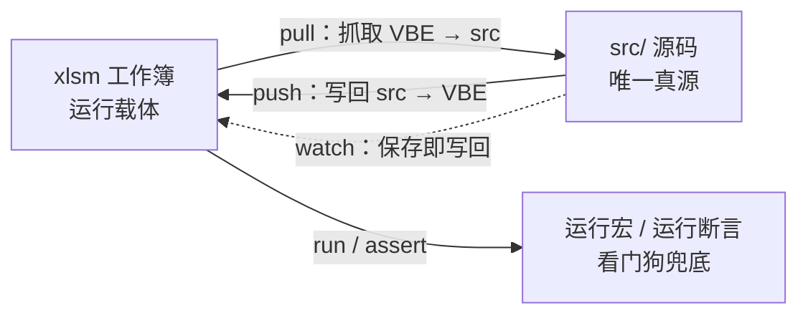

# vba-workbench

> 把锁在`.xlsm`里的 VBA 放出来：AI 能改代码、能运行测试，Git 能记录版本并回滚。
> 版本：1.6.13・平台：Windows + 微软 Excel・Python 3.10+・许可证：SNSA-1.0

## 为什么需要它

VBA 仍然能解决大量办公自动化问题，但它被困在 VBE（VBA 编辑器）这个封闭环境里：代码只保存在 `.xlsm` 的二进制工程中，改一个模块要打开 VBE，改完只能人工打开工作簿验证。

真正低效的不是 “写代码”，而是 “修改、测试、同步代码” 这一整圈。

| 现在的痛点                   | 带来的结果                              |
| ----------------------- | ---------------------------------- |
| 代码只保存在 `.xlsm` 二进制工程里   | Git 只能管理整个工作簿文件，不能按模块查看 diff、审查和回滚 |
| 改代码只能打开 VBE 手工操作        | 跨模块批量改、重命名、统一风格全靠手工                |
| 改完只能人工点击按钮验证            | 没有自动断言，回归靠记忆，改 A 坏 B 很难发现          |
| 多个工作簿共用的模块靠复制           | 版本很快漂移，修一个工作簿要逐个同步                 |
| 通用 AI 工具默认无法直接读写 VBA 工程 | 只能给出一段代码，仍需手工粘贴、保存和测试              |

`vba-workbench` 不是单点导出工具，而是一条 VBA 开发流水线：**抓取 → 修改 → 写回 → 运行 → 断言 → 盘点 / 修复 → 交付**。

它把 VBA 工程同步成 `src/` 源码文件；AI 和 IDE 直接改这层代码，Git 记录差异并支持回滚，工具负责安全写回工作簿。

不需要重写现有 VBA，也不需要放弃现有 Excel 工程；只把开发层从 VBE 搬到 `src/`。

价值不只是 “把代码导出来”，而是缩短 “修改 — 验证” 循环：改完立即写回、运行、查看断言，失败继续改，不用在 VBE 和 Excel 之间来回切换。循环顺畅之后，VBA 才能像普通软件项目一样持续迭代。

**全链路自动化**

- 抓取源码、写回、运行宏、运行断言、盘点、修复、备份 / 交付在同一套机制里完成。
- 写回步骤可预览、可备份、可回读校验，失败可回滚；只读步骤不改工作簿。
- 批量动作可一次覆盖多个工作簿，不再逐个手工操作。

**看门狗与隔离运行**

- **断言看门狗**：运行断言有总超时预算，死循环或弹窗不会无限等待。
- **错误分流**：超时、Excel 已退出、VBE 编译错误、MsgBox / InputBox 分开报错，Agent 能按错误继续处理。
- **隔离运行**：运行宏可开隔离实例，结束后清理自己打开的 Excel，不影响用户会话。

**不绑定 Agent，也不绑定 IDE**

- 不限定 Agent 平台：Claude Code、Cursor、Codex、豆包，或自研 Agent 都能接入；只要能读写 `src/` 源码、能调用本目录脚本，就能完成 “改代码 → 写回 → 验证”。
- 不限定 IDE：VS Code、Cursor、Trae、Sublime Text、Notepad++ 都能直接打开 `src/`；源码是 UTF-8 文件，搜索、跳转、快速浏览、批量替换、Git diff 都可正常使用。
- `vba-workbench` 是普通目录和脚本，不绑定某个 Agent 平台；不用 Skill 机制也能通过菜单或命令行使用。

**AI 具体能做什么**

不是 “让 AI 写一段 VBA”，而是让它承担从需求到验收的整段开发工作：读取 `src/` 源码、修改 `src/` 代码，再由工具写回、运行宏、查看断言结果；失败就按日志继续修改。

- **新功能开发**：AI 先读现有模块、窗体和调用入口的代码，再新增或改造模块、调用链和自测宏；写回后实际运行验证，按结果继续修改代码。适合加入导入、报表、批处理、窗体按钮等功能。
- **现有项目优化**：先只读盘点引用、公共库、重复模块、结构问题和体检指标，按阻断项 / 建议项分级给方案；确认后用批量补丁、格式修复修改 `src/` 里的代码，写回后重新运行同一套指标，对比前后。
- **Bug 修复与回归**：从错误码、日志和源码位置定位；只改对应模块，补一条回归断言，再写回并重新运行，避免修好一个又引入新的问题。
- **跨工作簿批量**：公共模块只保留一份，批量写回多个工作簿；先预览影响范围，再执行。
- **交付前**：在 Git diff 上审查改动，执行脱敏扫描和全量断言，确认备份已完成，输出变更清单与回滚点。

这些流程不是演示：vba-workbench 自身的 1.6.x 迭代（分层重构、交互菜单、看门狗、发布门禁）和真实工作簿上的指标优化、隔离运行宏，都沿用这条链路。

AI 不直接操作 VBE：它只改 `src/` 里的代码，写回和验证由工具执行；写回前可预览，失败可回滚。

一句话：`xlsm` 是运行载体，`src/` 是开发源码；Agent / IDE 改代码，工具安全写回，看门狗兜底。



***

## 怎么用：按使用方式选入口

| 使用者                   | 入口                                                                              | 一句话                                 |
| --------------------- | ------------------------------------------------------------------------------- | ----------------------------------- |
| **人**                 | 双击 `vba-workbench\scripts\启动菜单.bat`                                             | 选项目、选动作；写操作自动预览，回车执行，不用记命令          |
| **AI 助手 / 第三方 Agent** | 让 Agent 读到整个 `vba-workbench/`；支持 Skill 机制的平台放进 `.skills/`，不支持就直接给 `SKILL.md` 路径 | 用自然语言说清 “项目 + 目标 + 边界”，由 Agent 执行   |
| **常见 IDE**            | 用 VS Code、Cursor、Trae 等打开 `src/`                                                | 搜索、跳转、批量替换、Git diff；改完由菜单或 Agent 写回 |

日常操作只需菜单；`sync.py`、`audit.py`、`agent.py` 是菜单背后的执行器，也是 Agent 的接口。IDE 只改 `src/` 里的代码，不直接改工作簿；写回走菜单或 Agent。

***

## 日常使用

### 主入口：双击 `启动菜单.bat`

位置：`vba-workbench\scripts\启动菜单.bat`。

双击后会打开一个命令行窗口，按编号选择：

1. **选项目**：菜单列出 `mapping.json` 里的项目，输入编号；
2. **选动作**：列出这个项目能做的事，输入编号。

只读动作选中后直接运行；写操作选中后自动先预览，预览通过后再回车执行，输入 **0** 返回上一层。动作结束后自动回到当前菜单，可以连续操作，不会被退出。

菜单效果如下（示例项目）：

**① 选项目**

```
  ════════════════════════════════════════════════════
  vba-workbench 启动菜单
  ════════════════════════════════════════════════════

  【选择项目】
  ────────────────────────────────────────────────────
  1. 示例表A（src/projects/示例表A）
  2. 全局工具
  3. ＋ 新建项目（拖入 .xlsm）

  ────────────────────────────────────────────────────
  0. 退出

选项目编号：1
```

**② 选动作**

```
  【项目：示例表A · 选择动作】
  ────────────────────────────────────────────────────
  1. 抓取源码 VBE→src
  2. 抓取已打开工作簿的未保存改动
  3. 推荐模式与下一步（只读）
  4. 写回源码 src→VBE
  5. 换公共库占位壳
  6. 导出 GBK 副本
  7. 核对模块清单（只读）
  8. 常驻自动写回

  ────────────────────────────────────────────────────
  0. 返回项目列表

选动作编号：4
```

**③ 写操作自动预览，再回车执行**

```
—— 预览，未修改任何文件 ——
源码预检：17 个模块，致命 0，提醒 2
将写回：公共库 3 个 + 项目 14 个
目标工作簿：示例表A V3.xlsm

—— 预览结束，未修改任何文件 ——

  ────────────────────────────────────────────────────
  回车 = 执行
  0    = 返回

回车

备份：.backup/20261126-214500-写回前/示例表A V3.xlsm
写回 17 个模块；回读一致；已保存

—— 完成，返回动作菜单 ——
```

### 首次使用

只需要准备一次：

1. 安装 Python 3.10+，进入 `vba-workbench\` 目录后执行 `python -m pip install -r requirements.txt`；
2. Excel 信任中心勾选「信任对 VBA 工程对象模型的访问」；
3. 目标工作簿的 VBA 工程已解除密码保护；
4. 双击 `启动菜单.bat`，在项目列表里选 **“＋ 新建项目（拖入 .xlsm）”**，把要登记的工作簿拖进窗口后回车；直接回车会打开文件选择框。

```
选项目编号：2

  【新建项目】
  ────────────────────────────────────────────────────
  把 .xlsm / .xlsb 拖进本窗口后回车
  直接回车 = 打开文件选择框

  ────────────────────────────────────────────────────
  0. 取消

> "D:\表格\示例表A V3.xlsm"

已识别：示例表A
  目录：D:\表格
  版本规则：示例表A V<数字>.xlsm（自动取最高版本）
正在建立并抓取源码……
—— 已创建项目并抓取源码 ——
```

建立完成后自动抓取一次源码，并直接进入该项目的动作菜单；按 0 返回项目列表，不用重新启动菜单。

命名规则：文件名带 ` V<数字>` 时，项目名和前缀自动去掉版本号，以后按版本号取最大，例如 `示例表A V100.xlsm`；文件名没有版本号时，按这个文件精确登记，不再要求改名。

如果还没有 `mapping.json`，菜单也会直接打开，并提示你先新建项目，不会报错退出。

### 菜单能做什么

选完项目后，能看到这些动作：

| 菜单动作           | 作用                                 |
| -------------- | ---------------------------------- |
| 抓取源码 VBE→src   | 把工作簿里的代码抓进 `src/`                  |
| 抓取已打开工作簿的未保存改动 | 只从已打开的 Excel 会话抓取，适合工作簿里还有未保存修改的情况 |
| 推荐模式与下一步（只读）   | 告诉你当前该抓取还是写回                       |
| 写回源码 src→VBE   | 把 `src/` 里的代码写回工作簿；会先预检、备份、回读校验    |
| 换公共库占位壳        | 把项目里重复的公共模块正文改成占位壳                 |
| 导出 GBK 副本      | 生成一份 GBK 副本，不改 `src/` 里的代码         |
| 核对模块清单（只读）     | 与最近一次备份对比模块集合                      |
| 常驻自动写回         | 监听已打开的工作簿，改哪个模块就写回哪个模块；会先问监听多少秒    |

另外还有一组维护 / 检查动作，在项目列表里选 **“全局工具”** 后使用；它们不依赖具体项目：

| 菜单动作             | 作用                                 |
| ---------------- | ---------------------------------- |
| 列出各项目解析到哪个工作簿    | 核对 `mapping.json` 是否配置正确           |
| 核对公共库版本          | 核对公共库版本，以及各项目锁定的版本                 |
| 环境体检             | 检查 Excel、pywin32、VBA 工程访问权限、配置是否正常 |
| 补 / 清公共库占位壳      | 维护项目目录里的占位壳                        |
| 清理 `.backup` 旧批次 | 选中后先预览，回车再删旧备份                     |

### 日常使用的四条原则

1. **写操作自动预览**：选中写动作后先显示预览；确认无误再回车执行，输入 0 返回。没有单独的 “预览 / 执行” 选项。
2. **改源码后不会自动生效**：只改 `src/` 里的代码，要在菜单里执行一次 “写回源码”，或开启 “常驻自动写回”。
3. **公共模块正文只有一份**：`src/common` 是唯一正文，项目目录里的同名文件只是占位壳，改它不会生效。
4. **常驻写回必须设时长**：菜单默认 600 秒；需要提前结束就按 `Ctrl+C`。

### 菜单不负责什么

菜单负责日常单工作簿同步，以及少量全局检查。下面这些仍交给 AI 助手或命令行：

- 多工作簿批量写回；
- 运行宏；
- 引用 / 结构盘点；
- 格式批量检查与修复；
- 需要额外必填参数的动作，例如指定模块。

***

## Agent / AI 助手怎么用

### 怎么把项目交给 Agent

1. 把整个 `vba-workbench/` 目录放到 Agent 能读取的位置，不要只放 `SKILL.md`；`scripts/`、`references/` 必须一起放入。
2. 支持 Skill 机制的平台放进 `.skills/` 并刷新列表；不支持的平台直接把目录或 `SKILL.md` 路径交给它。
3. 验证是否加载成功：对 Agent 说 “用 vba-workbench 先做环境体检和项目清单，只读，不要修改工作簿”。能返回 Excel、pywin32、VBA 工程访问权限和项目列表，就说明生效。
4. Agent 的操作规范以 `SKILL.md` 为准；README 只负责介绍项目，不充当命令手册。

换 Agent 平台时，把 `SKILL.md` 的路径告诉它，并保留完整目录；不要只发一份 `SKILL.md`。

### 怎么给 Agent 下任务

不用拼接命令行参数，也不用记各种开关。把三件事说清楚：

| 要说清 | 说明                  | 例子                   |
| --- | ------------------- | -------------------- |
| 项目  | 操作哪个工作簿             | 示例表 A                |
| 目标  | 要完成什么               | 抓取 / 写回 / 运行宏 / 盘点引用 |
| 边界  | 能不能写回、写前要不要备份、哪些不能动 | 先预览，不要写回；写前备份；不改业务数据 |

可以直接这样说：

- **新功能开发**：“给示例表 A 新增批量导入功能：先只读梳理现有入口和模块，给我改动计划；确认后改 `src/` 里的代码，补一个自测宏，先预览写回，再运行断言。”
- **现有项目优化**：“对示例表 A 做只读体检，按阻断项 / 建议项列出问题和最小改法；确认后批量修复代码，写回后重新运行同一套指标，给我前后对比。”
- **修断言失败**：“「运行全部断言」失败了，先读日志和错误码定位到模块，不要改；给我最小修复和一条回归断言，确认后再写回并重新运行。”
- **跨工作簿批量**：“把 `src/common` 的代码改动批量写回所有相关项目，先预览影响范围，不要直接执行。”

Agent 会自己按 `SKILL.md` 判断该用哪种能力；你只需要查看它返回的结果和影响范围。第一次做写回动作，明确说 “先预览”。

### 能力全景：准备 → 抓取 → 写回 → 运行 → 检查 → 修改 → 交付

按这 7 组理解，使用时先判断当前处于哪一步。

底层有 32 个动作，下面把同类合并成 31 项能力；`sync` 与 `agent` 两个写回入口算同一项。

**准备：先把环境和项目说清楚**

| 能力        | 能做什么                                          |
| --------- | --------------------------------------------- |
| 环境体检      | 检查 Excel、pywin32、VBA 工程访问权限、配置是否可正常运行         |
| 项目清单      | 每个项目当前解析到哪个 `xlsm`                            |
| 新建 / 更新项目 | 生成或更新 `mapping.json` 与 `src/` 目录结构            |
| 项目状态一览    | 磁盘上是否存在工作簿、Excel 是否已打开、VBA 工程能否访问、模块数、测试工作表行数 |
| 可见工作簿开关   | 需要人工打开 VBE 或手工解除保护时，打开或关闭可见工作簿                |
| 模式推荐      | 按当前状态建议抓取、写回、运行宏还是监听，以及是否需要先打开工作簿             |

**抓取：把工作簿里的代码抓取到** `src/` **目录**

| 能力     | 能做什么                              |
| ------ | --------------------------------- |
| 抓取源码   | 工作簿 → `src/`；已打开则借用会话，未打开则自动开隐藏实例 |
| 抓未保存改动 | 只从已打开的工作簿抓取，包含尚未保存的修改             |

**写回：把** `src/` **目录中的代码写回工作簿**

| 能力   | 能做什么                                  |
| ---- | ------------------------------------- |
| 写回源码 | `src/` → 工作簿；预检、备份、写回、回读校验，支持多工作簿一次写回 |
| 常驻写回 | 监听已打开的工作簿，源码一变就写回；必须设监听时长             |

**运行：在 Excel 中实际执行宏和断言**

| 能力   | 能做什么                       |
| ---- | -------------------------- |
| 运行宏  | 写回后运行指定宏，可传参、隔离、保存、查看日志尾部  |
| 运行断言 | 运行断言宏，核对通过 / 失败计数，由看门狗控制超时 |

**检查：只读盘点，不改代码**

| 能力     | 能做什么                                        |
| ------ | ------------------------------------------- |
| 成员引用   | 查询某个模块被哪些代码调用，用于删除前确认影响范围                   |
| 公共库盘点  | 每个公共模块的引用数、体积、瘦身建议                          |
| 项目依赖矩阵 | 某个工作簿依赖哪些模块和公共模块                            |
| 结构问题   | 旧副本、无正文的占位壳、缺失的占位壳、重名过程、文档模块对应关系核对、规则被改回旧版本 |
| 体检指标   | 重新计算 H01–H19 指标                             |
| 汇总意见   | 公共库和结构问题一次给出结论                              |
| 模块清单核对 | 各工作簿模块集合与最近一次备份对比                           |
| 复杂度体检  | 过程长度、封装过薄、模块变量、布尔参数、`On Error` 使用方式         |

**修改：调整** `src/` **目录中的代码和结构**

| 能力        | 能做什么                                    |
| --------- | --------------------------------------- |
| 格式检查 / 修复 | 行尾 / BOM、调用括号、`Option Explicit`；可只检查或修复 |
| 批量补丁      | 按整行代码块清单替换源码，先预览核对命中                    |
| 占位壳补 / 清  | 公共库同名占位壳的创建与清理                          |
| 旧真身换壳     | 项目里同名公共模块的旧正文改成占位壳                      |
| 模块晋升公共库   | 把一个模块从项目源码移动到 `src/common`              |

**交付：备份、导出与验收**

| 能力        | 能做什么                             |
| --------- | -------------------------------- |
| 导出 GBK 副本 | 给旧环境或旧工具一份 GBK 副本，不改 `src/` 里的代码 |
| 整工作簿备份    | 写回前额外备份整个工作簿                     |
| 日志摘要      | 查看最近一次运行或测试日志的尾部                 |
| 清理旧备份     | 按保留批次数清理 `.backup`，默认只预览         |
| 脱敏扫描      | 按配置词表扫描交付文件，命中即失败                |
| 公共库版本核对   | 核对公共库版本与各项目锁定版本是否一致              |

不确定选哪项时，直接说 “先帮我判断现在该做哪一步，只读”，Agent 会按当前模式推荐下一步。

完整参数、错误码和边界在 `SKILL.md` 与 `references/commands.md`；日常不需要读。

### 更新或发版

替换整个 `vba-workbench/` 目录，保留工作区的 `mapping.json` 和 `src/`；刷新 Skill 列表后先做只读体检。打包、校验和脱敏按 `references/release.md`。

### Agent 使用边界

- 不直接启动 Excel；需要可见工作簿时，使用 Skill 提供的打开能力。
- 不要在同一个 Excel 实例上并行写入；常驻监听不要无限期运行。
- 不操作未登记工作簿；项目全集以 Skill 的项目清单为准。
- 只改 `src/` 里的代码，写回时只更新 VBA 模块，不改业务数据。
- 工程有密码保护时先解除保护；Excel 忙或弹窗时先处理，不要盲目重试。
- 写回前先预览，确认影响范围后再执行。

***

## 命令行入口（备查）

日常不需要；Agent 会按 `SKILL.md` 自己选择，不需要手工拼接命令。只有编写批处理脚本、排障或 CI 时才需要手工调用 `scripts/sync.py`、`scripts/audit.py`、`scripts/agent.py`；完整命令与参数见 `references/commands.md`。

***

## 常见任务怎么选

| 场景               | 人：用菜单           | Agent：这样说                                      |
| ---------------- | --------------- | ---------------------------------------------- |
| **新功能开发**        | 菜单不提供，交给 AI 助手  | “先读现有入口，给改动计划；确认后改 `src/` 里的代码、补自测宏、预览写回、运行断言” |
| **现有项目优化**       | 菜单不提供，交给 AI 助手  | “先只读体检，按阻断项 / 建议项给最小改法；确认后修复代码并重新运行指标”         |
| **修断言失败**        | 菜单不提供，交给 AI 助手  | “先读日志定位，给最小修复和回归断言；确认后写回并重新运行”                 |
| 工作簿里改完，抓取源码      | 选「抓取源码 VBE→src」 | “把示例表 A 的代码抓进 `src/`，先预览”                      |
| 工作簿已打开、有未保存改动    | 选「抓取已打开表的未保存改动」 | “抓取示例表 A 已打开工作簿的未保存改动”                         |
| 源码改完，写回工作簿       | 选「写回源码 src→VBE」 | “把 `src/` 里的代码写回示例表 A，先预览”                     |
| 边改边自动写回          | 选「常驻自动写回」，设监听秒数 | “监听示例表 A，改完自动写回，先监听 10 分钟”                     |
| 不确定抓取还是写回        | 选「推荐模式与下一步」     | “示例表 A 该抓还是该写回？先只读判断”                          |
| 多工作簿批量写回         | 菜单不提供，交给 AI 助手  | “把所有相关项目的 `src/` 代码写回工作簿，先预览”                  |
| 运行宏 / 查引用 / 格式检查 | 菜单不提供，交给 AI 助手  | “给示例表 A 运行宏 X” / “盘点引用” / “检查格式”               |

***

## 文档导航

| 目的                      | 读什么                           |
| ----------------------- | ----------------------------- |
| Agent 加载、能力与调用规范        | `SKILL.md`                    |
| 工作簿 / 工作表、抓取 / 写回等术语统一  | `SKILL.md` 的 “术语约定”           |
| 完整命令、参数、JSON 字段         | `references/commands.md`      |
| 同步原理与数据流                | `references/sync.md`          |
| `mapping.json`、换版本、目录命名 | `references/sync-config.md`   |
| 修改内部代码、增加命令、查看硬规则       | `references/sync-maintain.md` |
| 调用链、分层、每个 Python 文件的功能  | `references/architecture.md`  |
| 审计规则与结构检查               | `references/audit.md`         |
| 公共基础函数与下沉原则             | `references/toolkit.md`       |
| 常见问题与错误处理               | `references/pitfalls.md`      |
| 发布打包与验收                 | `references/release.md`       |

***

## 边界

- 仅支持 Windows + 微软 Excel；WPS、Mac Excel、非 Windows 环境不适用。
- 没有 Web 服务、没有数据库；不负责联网协作。
- `*.xlsm` 不纳入版本库；`src/` 始终为 UTF-8（无 BOM）+ LF。
- 写回前备份整个工作簿；写回后默认保存，`--no-save` 可只改内存。
- 文档与示例必须脱敏：真实用户名、机器名、工作簿名、工作表名、客户名、经营数字不进入发布包。
- 许可证为 `SNSA-1.0`：允许公开托管与分发，但不是 OSI 开源，禁止销售。
