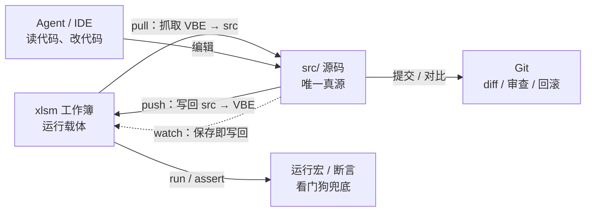

# vba-workbench

> 把锁在 `.xlsm` 里的 VBA 同步成可 diff 的 `src/`：Git 记录版本，AI / IDE 改代码，工具安全写回并运行断言。

**Windows + 微软 Excel** · **Python 3.10+** · **v1.7.1** · **SNSA-1.0**

[3 分钟上手](#quickstart) · [核心工作流](#workflow) · [日常菜单](#menu) · [交给 Agent](#agent) · [文档导航](#docs)

<a id="what"></a>
## 这是什么

`vba-workbench` 不是单点导出工具，而是一条 VBA 开发流水线：

**抓取 → 修改 → 写回 → 运行 → 断言 → 盘点 / 修复 → 交付**

它把 VBA 工程同步成 `src/` 源码文件；AI 和 IDE 直接改这层代码，Git 记录差异并支持回滚，工具负责安全写回工作簿。不需要重写现有 VBA，也不需要放弃现有 Excel 工程。

- `xlsm` 是运行载体，`src/` 是开发源码。
- Agent / IDE 只改 `src/`，工具负责写回、备份和回读校验。
- 运行断言有看门狗，死循环或弹窗不会无限等待。

**适合**：已有 `.xlsm` 项目，想用 Git / AI / IDE 维护 VBA，或需要批量修改和回归验证的人。

**不适合**：WPS、Mac Excel、非 Windows 环境，或只需要一次性导出代码、不打算持续维护的项目。

## 为什么需要它

VBA 仍然能解决大量办公自动化问题，但它被困在 VBE（VBA 编辑器）这个封闭环境里：代码只保存在 `.xlsm` 的二进制工程中，改一个模块要打开 VBE，改完只能人工打开工作簿验证。

真正低效的不是 “写代码”，而是 “修改、同步、验证” 这一整圈。

| 现在的痛点 | 带来的结果 |
| --- | --- |
| 代码只保存在 `.xlsm` 二进制工程里 | Git 只能管理整个工作簿文件，不能按模块查看 diff、审查和回滚 |
| 改代码只能打开 VBE 手工操作 | 跨模块批量改、重命名、统一风格全靠手工 |
| 改完只能人工点击按钮验证 | 没有自动断言，回归靠记忆，改 A 坏 B 很难发现 |
| 多个工作簿共用的模块靠复制 | 版本很快漂移，修一个工作簿要逐个同步 |
| 通用 AI 工具默认无法直接读写 VBA 工程 | 只能给出一段代码，仍需手工粘贴、保存和测试 |

<a id="quickstart"></a>
## 3 分钟上手

### 1. 取得完整目录

下载 [main 源码压缩包](https://github.com/kinrt/vba-workbench/archive/refs/heads/main.zip)，或克隆仓库：

```bash
git clone https://github.com/kinrt/vba-workbench.git
cd vba-workbench
```

不要只复制 `SKILL.md`；`scripts/`、`references/` 必须和它放在一起。

### 2. 安装 Python 依赖

```bash
python -m pip install -r requirements.txt
```

### 3. 打开 Excel 的 VBA 工程访问权限

在 Excel「信任中心 → 宏设置」勾选：

**信任对 VBA 工程对象模型的访问**

目标工作簿的 VBA 工程如果设了密码，需要先解除保护。

### 4. 双击启动菜单

运行：

```text
vba-workbench\scripts\启动菜单.bat
```

在项目列表里选择 **“＋ 新建项目（拖入 .xlsm）”**，把工作簿拖进窗口后回车；直接回车会打开文件选择框。

建立完成后会自动抓取一次源码，并直接进入该项目的动作菜单。

<a id="workflow"></a>
## 核心工作流



1. **抓取**：把工作簿里的 VBA 模块抓进 `src/`。
2. **修改**：用 IDE 或 Agent 直接改 `src/` 里的代码，Git 正常 diff。
3. **预览**：写回前先看模块数、致命错误和影响范围，未确认不会改文件。
4. **写回**：工具更新 VBA 模块，写前备份，写后回读校验，失败可回滚。
5. **运行**：写回后运行宏或断言，按日志继续修，形成完整闭环。

写回只更新 VBA 模块，不改业务数据；只读动作不会修改工作簿。

<a id="menu"></a>
## 日常菜单

主入口是 `scripts\启动菜单.bat`。菜单会列出 `mapping.json` 里的项目，选项目后再选动作；只读动作直接运行，写操作自动先预览，预览通过后再回车执行。

一次典型的写回操作：

```text
【选择项目】
1. 示例表A（src/projects/示例表A）
2. 全局工具
3. ＋ 新建项目（拖入 .xlsm）

选项目编号：1

【项目：示例表A · 选择动作】
1. 抓取源码 VBE→src
4. 写回源码 src→VBE
8. 常驻自动写回

选动作编号：4

—— 预览，未修改任何文件 ——
源码预检：17 个模块，致命 0，提醒 2
将写回：公共库 3 个 + 项目 14 个
目标工作簿：示例表A V3.xlsm
—— 预览结束，未修改任何文件 ——

回车 = 执行
0    = 返回
```

动作结束后自动回到当前菜单，可以连续操作，不会被退出。

**四条日常原则**

1. **写操作自动预览**：选中写动作后先显示预览；确认无误再回车执行，输入 `0` 返回。
2. **改源码后不会自动生效**：要在菜单里执行一次 “写回源码”，或开启 “常驻自动写回”。
3. **公共模块正文只有一份**：`src/common` 是唯一正文，项目目录里的同名文件只是占位壳。
4. **常驻写回必须设时长**：菜单默认 600 秒；需要提前结束就按 `Ctrl+C`。

<details>
<summary>菜单动作与全局工具完整表</summary>

**项目动作**

| 菜单动作 | 作用 |
| --- | --- |
| 抓取源码 VBE→src | 把工作簿里的代码抓进 `src/` |
| 抓取已打开工作簿的未保存改动 | 只从已打开的 Excel 会话抓取，适合工作簿里还有未保存修改的情况 |
| 推荐模式与下一步（只读） | 告诉你当前该抓取还是写回 |
| 写回源码 src→VBE | 把 `src/` 里的代码写回工作簿；会先预检、备份、回读校验 |
| 换公共库占位壳 | 把项目里重复的公共模块正文改成占位壳 |
| 导出 GBK 副本 | 生成一份 GBK 副本，不改 `src/` 里的代码 |
| 核对模块清单与正文（只读） | 与最近一次备份对比模块集合和模块正文 |
| 常驻自动写回 | 监听已打开的工作簿，改哪个模块就写回哪个模块；会先问监听多少秒 |

**全局工具**

| 菜单动作 | 作用 |
| --- | --- |
| 列出各项目解析到哪个工作簿 | 核对 `mapping.json` 是否配置正确 |
| 核对公共库版本 | 核对公共库版本，以及各项目锁定的版本 |
| 环境体检 | 检查 Excel、pywin32、VBA 工程访问权限、配置是否正常 |
| 补 / 清公共库占位壳 | 维护项目目录里的占位壳 |
| 清理 `.backup` 旧批次 | 选中后先预览，回车再删旧备份 |

</details>

菜单负责日常单工作簿同步和少量全局检查。多工作簿批量写回、运行宏、引用 / 结构盘点、格式批量修复，交给 Agent 或命令行。

<a id="agent"></a>
## 交给 Agent / AI 助手

### 接入

1. 把整个 `vba-workbench/` 目录放到 Agent 能读取的位置，不要只放 `SKILL.md`；`scripts/`、`references/` 必须一起放入。
2. 支持 Skill 机制的平台放进 `.skills/` 并刷新列表；不支持的平台直接把目录或 `SKILL.md` 路径交给它。
3. 用一句只读任务验证是否加载成功：
   “用 vba-workbench 先做环境体检和项目清单，只读，不要修改工作簿。”

Agent 的操作规范以 `SKILL.md` 为准；README 只负责介绍项目，不充当命令手册。

### 下任务

不用拼接命令行参数。把三件事说清楚：

| 要说清 | 说明 | 例子 |
| --- | --- | --- |
| 项目 | 操作哪个工作簿 | 示例表 A |
| 目标 | 要完成什么 | 抓取 / 写回 / 运行宏 / 盘点引用 |
| 边界 | 能不能写回、写前要不要备份、哪些不能动 | 先预览，不要写回；写前备份；不改业务数据 |

可以直接这样说：

- **新功能开发**：“给示例表 A 新增批量导入功能：先只读梳理现有入口和模块，给我改动计划；确认后改 `src/` 里的代码，补一个自测宏，先预览写回，再运行断言。”
- **现有项目优化**：“对示例表 A 做只读体检，按阻断项 / 建议项列出问题和最小改法；确认后批量修复代码，写回后重新运行同一套指标，给我前后对比。”
- **修断言失败**：“「运行全部断言」失败了，先读日志和错误码定位到模块，不要改；给我最小修复和一条回归断言，确认后再写回并重新运行。”

更多可复制提示词见 [references/usage-examples.md](references/usage-examples.md)。

### 边界

- 不直接启动 Excel；需要可见工作簿时，使用 Skill 提供的打开能力。
- 不要在同一个 Excel 实例上并行写入；常驻监听不要无限期运行。
- 不操作未登记工作簿；项目全集以项目清单为准。
- 只改 `src/` 里的代码，写回时只更新 VBA 模块，不改业务数据。
- 工程有密码保护时先解除保护；Excel 忙或弹窗时先处理，不要盲目重试。
- 写回前先预览，确认影响范围后再执行。

<a id="capabilities"></a>
## 能力全景

按 7 个阶段理解，使用时先判断当前处于哪一步：

| 阶段 | 做什么 | 代表动作 |
| --- | --- | --- |
| 准备 | 把环境和项目说清楚 | 环境体检、项目清单、新建 / 更新项目、模式推荐 |
| 抓取 | 工作簿 → `src/` | 抓取源码、抓取未保存改动 |
| 写回 | `src/` → 工作簿 | 写回源码、常驻写回 |
| 运行 | 在 Excel 中实际执行 | 运行宏、运行断言 |
| 检查 | 只读盘点，不改代码 | 成员引用、公共库盘点、结构问题、体检指标 |
| 修改 | 调整 `src/` 代码和结构 | 格式检查 / 修复、批量补丁、占位壳补 / 清、模块晋升公共库 |
| 交付 | 备份、导出与验收 | 导出 GBK 副本、整工作簿备份、脱敏扫描、版本核对 |

完整 31 项能力表见 [references/capabilities.md](references/capabilities.md)。

<a id="faq"></a>
## 常见问题

**它和普通的 VBA 导出工具有什么区别？**

普通导出只解决 “把代码拿出来”。这里还负责写回、备份、回读校验、运行宏、断言和看门狗，形成可重复的开发闭环。

**会改坏工作簿吗？**

写回前会预检和备份，写后回读校验；失败可回滚。只读动作不修改工作簿。第一次使用仍建议先预览，或先备份原文件。

**必须用 AI 吗？**

不必须。人可以只用启动菜单，IDE 可以只改 `src/`；Agent 是加速批量修改和验证的可选入口。

**支持 WPS 或 Mac Excel 吗？**

不支持。当前只支持 Windows + 微软 Excel。

<a id="docs"></a>
## 文档导航

| 目的 | 读什么 |
| --- | --- |
| Agent 加载、能力与调用规范 | [`SKILL.md`](SKILL.md) |
| 完整能力表 | [`references/capabilities.md`](references/capabilities.md) |
| 可直接复制的提示词与命令行 | [`references/usage-examples.md`](references/usage-examples.md) |
| 完整命令、参数、JSON 字段 | [`references/commands.md`](references/commands.md) |
| 同步原理与数据流 | [`references/sync.md`](references/sync.md) |
| `mapping.json`、换版本、目录命名 | [`references/sync-config.md`](references/sync-config.md) |
| 修改内部代码、增加命令、查看硬规则 | [`references/sync-maintain.md`](references/sync-maintain.md) |
| 变更分级、接口约定、数据安全、测试门禁、评审清单 | [`references/change-standards.md`](references/change-standards.md) |
| VBA 工具整合评估、1.7.x 待审核队列 | [`references/vba-tool-integration.md`](references/vba-tool-integration.md) |
| 调用链、分层、每个 Python 文件的功能 | [`references/architecture.md`](references/architecture.md) |
| 审计规则与结构检查 | [`references/audit.md`](references/audit.md) |
| 公共基础函数与下沉原则 | [`references/toolkit.md`](references/toolkit.md) |
| 常见问题与错误处理 | [`references/pitfalls.md`](references/pitfalls.md) |
| 发布打包与验收 | [`references/release.md`](references/release.md) |

## 更新

替换整个 `vba-workbench/` 目录，保留工作区的 `mapping.json` 和 `src/`；刷新 Skill 列表后先做只读体检。打包、校验和脱敏按 [`references/release.md`](references/release.md)。

## 边界

- 仅支持 Windows + 微软 Excel；WPS、Mac Excel、非 Windows 环境不适用。
- 没有 Web 服务、没有数据库；不负责联网协作。
- `*.xlsm` 不纳入版本库；`src/` 始终为 UTF-8（无 BOM）+ LF。
- 写回前备份整个工作簿；写回后默认保存，`--no-save` 可只改内存。
- 文档与示例必须脱敏：真实用户名、机器名、工作簿名、工作表名、客户名、经营数字不进入发布包。

## 许可证

`SNSA-1.0`：允许公开托管与分发，但不是 OSI 开源，禁止销售。完整条款见 [LICENSE](LICENSE)。
